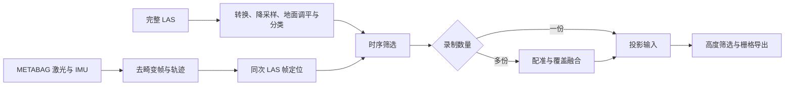
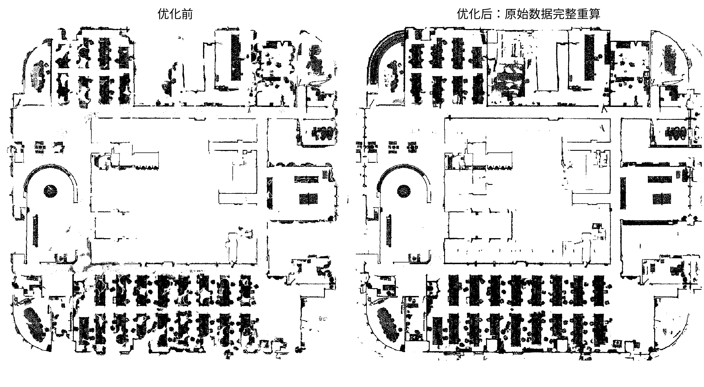

# MetaCam-RTK 原始数据处理与栅格建图

`pcd_process` 用于离线处理 **MetaCam-RTK 扫描仪的完整 LAS 点云和 METABAG 原始激光／IMU 数据**，生成筛选后的三维点云，以及供 ROS 2 地图服务使用的 **PGM＋YAML 二维占据栅格地图**。

**单份录制直接处理并导图；多份录制先分别处理，再配准、融合并导图。** 配置集中在 `config/Pipeline.yaml` 和 `config/Register.yaml`，各处理模块也可独立运行。

### 数据经过哪些处理



| 步骤 | 核心方法 | 生成内容 |
| --- | --- | --- |
| LAS 转换与预处理 | 读取完整 `colorized-realtime.las`，剔除无效点、体素降采样 | PCD、原始点数和来源索引 |
| 地面提取与调平 | 邻域法向、低位候选、RANSAC 主地面、刚体调平和局部高度分类 | 调平云、地面／障碍物分类、坐标变换 |
| 原始帧与位姿准备 | 解码 `data/data_*`，离线 FAST-LIO 去畸变及轨迹估计，再定位到同次 LAS | 逐帧点云、轨迹、`frames.csv` 与质量标志 |
| 时序筛选 | 多帧命中、可靠射线见证、弱命中与低密度联合筛选；地面和薄结构等受保护 | `cleaned.pcd`、删点证据及候选复核云 |
| 多份配准与融合 | 粗初值／FPFH＋RANSAC、点到平面 ICP，验收后按实际覆盖替换与接缝去重 | 完整融合云、逐轮矩阵和回滚资料 |
| 二维导图 | 选择投影模式、坐标和范围，按配置进行 SOR、高度筛选、XY 投影 | PGM、PNG、YAML |

LAS 提供完整三维几何，METABAG 提供时序筛选所需的逐帧观测。**`Preview.pcd` 仅用于预览，不作为完整数据输入。**

### 本轮优化带来的变化



左为本轮优化前，右为原始 LAS／METABAG 全部重算后的地图；使用相同坐标、范围和 5 cm 网格。墙线和房间边界更完整，孤立小块明显减少。

| 项目 | 优化前 | 优化后 |
| --- | --- | --- |
| 墙体投影 | 局部地面支持不足时，部分墙线未进入投影 | 多份导图使用共同坐标中的全局高度，保留这些墙体 |
| 散点处理 | 投影中存在较多孤立小块 | 联合时序证据、结构保护与导图 SOR，减少散点 |
| 运行方式 | 完整入口缺少单份分支 | 一份跳过配准；多份按任务配准融合 |
| 小连通块数量 | 920 个 | 176 个 |

小连通块统计来自 **2026-10-27 四份录制实验**，口径为同一坐标、范围和 5 cm 网格中的 8 邻接、面积不超过 4 格的占据块。该次四份云时序筛选共删除 165,370 点，受保护点删除数为 0；最终融合云为 6,187,454 点。上述改善由时序筛选与投影调整共同产生。

单份分支另用一份局部录制验证：329 帧，完成原始帧重算、时序筛选及导图，未执行配准融合。**仓库提供代码、必要组件及上述文档对照图，原始录制与完整运行产物不随仓库发布。**

## 1. 环境与依赖

已验证的 Python 版本为 **3.11**，Python 包版本见 [requirements.txt](requirements.txt)。
在已激活的 Python 3.11 环境中安装：

```bash
python -m pip install -r requirements.txt
```

| 使用范围 | 额外要求 |
| --- | --- |
| LAS / PCD 处理、配准、地图导出 | Python 依赖即可 |
| 原始 METABAG 重算 | CMake、C++17 编译器、Eigen、PCL、Python 3.12 开发库、ROS 2 Jazzy、Livox ROS 2 消息包 |

原始帧准备使用项目内的离线 FAST-LIO 源码，首次运行自动构建到 `build/raw_fastlio/`。
当前构建路径按本机 Ubuntu / ROS 2 环境配置；迁移环境时检查
[RawData/prepare.py](RawData/prepare.py) 的 `build()`，硬件与构建约定见
[RawData/DEPENDENCIES.txt](RawData/DEPENDENCIES.txt)。已有 PCD 的处理不需要构建这部分。

## 2. 快速开始

以下命令均在项目根目录执行。先核对 YAML 输入路径，并使用新的批次名；已有输出会拒绝覆盖。

### 2.1 从原始录制运行完整流程

在 [config/Pipeline.yaml](config/Pipeline.yaml) 的 `RunDataset.scans` 中设置录制名单。
每份目录需要 `colorized-realtime.las`、`data/data_*` 和 `info/calibration.json`。
公开配置使用 `data/<录制名>/` 作为示例输入路径。每份录制目录结构如下：

```text
data/<录制名>/
├── colorized-realtime.las       # 完整三维点云
├── data/
│   ├── data_0                  # METABAG 原始激光和 IMU 数据
│   └── data_1 ...
└── info/
    └── calibration.json        # 设备标定
```

先将自己的数据放入对应位置，或修改 YAML 的输入路径。
多份输入的配准任务在 [config/Register.yaml](config/Register.yaml) 的 `RunRegistration.jobs` 中设置。

```bash
python RunDataset.py --config config/Pipeline.yaml --batch-name your_batch_name
```

完整入口先执行 LAS 转换、单云处理、原始帧准备和时序筛选，再按录制数量选择后续步骤：

- **一份：** 跳过配准融合，使用 Pipeline 的投影与导图参数，发布 `result/cloud/processed.pcd` 和 `result/map/`。不读取 Register 配置，`reference_scan`、配准初值及多份地图坐标约定不参与此分支。
- **多份：** 按 Register 的任务配准融合后导图，发布 `fused.pcd`。

两种分支均保存配置快照、阶段命令和验收结果。单份的 `scans` 项可省略 `initial_raw_to_reference`。

当前示例包含 `old22`、`full`、`local_01`、`local_02`，以 `full` 为参考。
多份输入更换录制名单时，同步检查配准任务的 `source`、`target`、初值和坐标变换。
示例矩阵、保护框和裁剪范围对应原实验场景，更换数据时需要重新配置。
完整入口始终启用原始帧重算和时序筛选。多份分支需要 `RunRegistration.export_map=true`；
其 `map_latest` 坐标导出仅支持 `map_quarter_turns=1`，即逆时针 90°。

### 2.2 单份点云与处理后点云

| 入口 | 配置 | 输入与职责 |
| --- | --- | --- |
| `RunDataset.py` | Pipeline；多份另读 Register | 原始 LAS、METABAG → 单份地图或配准融合批次 |
| `RunPointCloudPipeline.py` | Pipeline | 单份 PCD → 预处理、地面、裁剪、可选时序筛选 |
| `RunRegistration.py` | Register | 已处理 PCD → 逐轮配准、融合与地图 |

LAS 转换和单云处理：

```bash
python FormatChange/01LastoPcd.py --config config/Pipeline.yaml
python RunPointCloudPipeline.py --config config/Pipeline.yaml
```

已有 PCD 时，直接配置 `PreprocessPointCloud.input_pcd`，跳过 LAS 转换。
独立单云入口由 `enable_temporal_filter` 控制时序步骤：启用时，
`PrepareTemporalFrames.enabled=true` 表示从原始 METABAG 重算，否则使用提供的 `frames_csv`。
`export_grid_input` 只控制是否额外生成单云投影输入。

处理后点云的配准融合：

```bash
python RunRegistration.py --config config/Register.yaml
```

后续任务用 `target: previous` 读取上一轮实际融合输出。
任务内的 `parameters`、`fusion_parameters` 只覆盖该轮需要变化的参数。
`initial_transform=null` 继承 Run 公共初值；均为空时自动搜索。
初值方向为 **处理后 source → target**，可填写 4×4 矩阵或矩阵文件路径。

### 2.3 子模块独立运行

每个子模块支持 `--config`，前提是该节配置的输入及旁文件已存在。
不要先独立生成阶段目录，再在同一目录启动 Run；两者都会拒绝覆盖已有阶段。

| 脚本 | 默认配置 | 输入 → 输出 |
| --- | --- | --- |
| `FormatChange/01LastoPcd.py` | Pipeline | LAS → PCD |
| `Pipeline/01PreprocessPointCloud.py` | Pipeline | PCD → 无效点处理、可选体素与 SOR |
| `Pipeline/02ExtractGround.py` | Pipeline | 预处理云 → 调平云、地面分类及变换 |
| `Pipeline/03CropPointCloud.py` | Pipeline | 调平云 → 裁剪结果；`mode=none` 时复用上游云 |
| `RawData/prepare.py` | Pipeline | 原始 METABAG + 预处理云、调平矩阵 → 去畸变帧与位姿 CSV |
| `Pipeline/05TemporalFilter.py` | Pipeline | 单录制云 + 合格帧 CSV → 筛选云、候选与证据 |
| `Register/01RegisterPointClouds.py` | Register | 两份处理云 → 对齐云、矩阵与配准报告 |
| `Register/02FusePointClouds.py` | Register | 已对齐云 → 融合云及回滚资料 |
| `Pipeline/04PrepareGridInput.py` | Pipeline | 有地面分类的完整云 → 投影输入与来源记录 |
| `FormatChange/03PcdtoGridMap.py` | Pipeline | 投影输入 → PGM、PNG、YAML |
| `FormatChange/02PcdtoPly.py` | Pipeline | PCD → PLY 预览 |
| `Common/CheckPointCloudPipeline.py` | Pipeline | Run 汇总报告 → 验收记录 |

共享模块处理融合结果时显式选择 Register 配置，例如：

```bash
python Pipeline/04PrepareGridInput.py --config config/Register.yaml
python FormatChange/03PcdtoGridMap.py --config config/Register.yaml
```

Run 发布 `processed.pcd` 及 `.pcd.npz` 作为单云固定出口。
独立执行 `05TemporalFilter` 只保存自身的 `cleaned.pcd`，不覆盖已有固定出口；
需要使用它时，显式修改下游输入。检查模块需要 Run 的汇总报告，不能仅凭若干独立阶段生成验收结果。

## 3. 代码与配置

### 3.1 模块职责

```text
RunDataset.py                 原始录制的完整批次编排
RunPointCloudPipeline.py      单云流程编排
RunRegistration.py            配准、融合及导图编排
Common/                       配置、路径、点云属性和验收
FormatChange/                 LAS、PCD、PLY 与栅格格式转换
Pipeline/                     预处理、地面、裁剪、投影与时序筛选
Register/                     配准与融合算法
RawData/                      METABAG、离线 LIO、帧定位和索引核验
Tools/                        结果对照、复算核对与归档
config/                       Pipeline.yaml、Register.yaml
tests/                        临时合成数据回归检查
```

实际单云顺序为：预处理 → 地面 → 裁剪 → 可选原始帧准备 → 可选 `05TemporalFilter` → 可选 `04PrepareGridInput`。
配准只使用完整三维处理云，投影派生云只用于导图。

### 3.2 配置与关键参数

- **单份：** `RunDataset.scans` 只保留一项，设置名称、LAS 路径、射线开关和保护框；无需配准初值，导图使用 Pipeline 的参数。
- **多份：** 另外指定 `reference_scan`，为各扫描设置 `initial_raw_to_reference`，并在 Register 中配置 `RunRegistration.jobs`。扫描名单不会自动生成配准任务。
- RAW 初值的方向为 **本录制原始 LAS → 参考录制原始 LAS**；入口按本次调平矩阵换算后交给配准模块。可由已核对的历史配准结果或对应点粗配准获得，不能直接使用处理后云的矩阵。

`ROOT_DIR: ..` 相对 **YAML 所在目录** 解析，其他普通相对路径以 `ROOT_DIR` 为基准。
模块输入输出与 `parameters` 分开设置；用 `{模块名.字段名}` 复用上游路径。

| 常用占位符 | 含义 |
| --- | --- |
| `{ROOT_DIR}` | 项目根目录 |
| `{RUN_ROOT}` / `{ACTIVE_ROOT}` | 正式批次 / 当前正式或试验根目录 |
| `{WORK_DIR}` / `{RESULT_DIR}` | 当前过程 / 结果目录 |
| `{SCAN_ROOT}` / `{SCAN_DIR}` / `{SCAN_NAME}` | 所有单云 / 当前单云目录 / 当前录制名 |
| `{REGISTRATION_ROOT}` / `{JOB_DIR}` | 配准任务根目录 / 当前轮或独立任务目录 |

配置检查会拒绝重复键、未知字段、类型错误、未知占位符和路径循环。
有名称的参数保留行尾注释；`[关键]` 表示修改后应检查点云或地图结果。

| 参数位置 | 修改时重点检查 |
| --- | --- |
| `run`、各模块 `output_dir` | 新批次、扫描及试验名称；独立运行时保持两份 YAML 指向预期批次 |
| `PreprocessPointCloud.parameters` 的 `voxel_size`、`statistical` | 点密度与滤波位置；当前配置为 5 cm 体素，预处理不做 SOR |
| `TemporalFilter.mode`、`sparse_filter`、`protected_bounds` | `review` 只标记，`apply` 才删点；保护框与输入坐标必须对应 |
| `PrepareTemporalFrames.allow_free_space` | 是否允许合格帧参与射线见证；不能用它代替帧质量检查 |
| 配准 `initial_transform`、误差门槛、`check_stability` | 初值方向、留出误差与扰动稳定性；未通过即停止融合 |
| `FusePointClouds.priority`、覆盖及去重距离 | 新旧扫描的保留次序与拼接边界 |
| `PrepareGridInput.selection_mode`、变换和范围 | `local_ground` 使用局部支持；`global_height` 保留共同坐标真实高度 |
| `PcdtoGridMap` 高度范围、SOR、分辨率 | 当前 Register 配置为 0.28–2.0 m、5 cm、导图时 SOR |
| `PcdtoGridMap.unknown_as_free` | `true` 会把未知区域写为空闲；这是导出策略 |
| `RunDataset` 初值、参考云及地图变换 | RAW 初值与处理后初值不能混用；坐标导出须同步图像和原点 |

两种投影模式不能混用高度含义：`global_height` 要求 `normalize_local_ground=false`。
当前独立单云配置使用局部相对高度，配准导图配置使用全局高度；以所选 YAML 为准。

时序 CSV 至少包含 `file`、`stamp`、质量标志、留出残差和 `m00...m33`。
位姿方向为 **单帧 → 当前处理云**；`left_transform_file` 可追加本次调平矩阵。
BIN 必须声明 `point_format=xyzi_float32_le`。地面、结构和光学保护限制删点范围；
稀疏统计排除不代表已确认运动。只有同次录制的帧可用于筛选该份云。

### 3.3 输出结构

```text
run/<batch_name>/
├── dataset_manifest.json          # 完整入口：输入哈希、阶段命令与状态
├── manifest.json                  # 单份或配准批次的状态与结果入口
├── work/
│   ├── configs/                   # 本次可独立运行的 YAML 快照
│   ├── logs/                      # 各入口的执行日志
│   ├── 00_input/                  # LAS 转换 PCD 与 initials/ 初值
│   ├── 00_frames/<scan>/          # 原始审计、LIO、帧定位、frames.csv
│   ├── 01_preprocess/<scan>/
│   │   ├── 01_preprocess/         # cleaned.pcd 与预处理记录
│   │   ├── 02_ground/             # 调平云、分类、地面模型及矩阵
│   │   ├── 03_crop/               # 裁剪记录；可复用上游云
│   │   ├── 04_temporal/           # 筛选云、候选复核云、证据与报告
│   │   ├── 05_grid_input/         # 仅单云 export_grid_input=true
│   │   ├── processed.pcd         # 单云固定出口，附 .pcd.npz
│   │   ├── T_input_to_processed.npy
│   │   ├── pipeline_report.json
│   │   └── validation.json
│   ├── 02_registration/<job>/     # 对齐、融合、回滚资料与验收
│   └── 03_grid_input/             # 批次投影输入与 export_selection.npz
├── result/
│   ├── cloud/                     # 单份 processed.pcd；多份 fused.pcd；仅配准 aligned.pcd
│   ├── map/                       # 原投影坐标中的 PGM、PNG、YAML
│   ├── map_latest/                # 多份完整入口额外导出的固定坐标地图
│   ├── preview/                   # 可选 PLY 预览
│   ├── transforms/                # 每轮处理后 source → target 矩阵
│   ├── result_report.json
│   └── validation.json
└── experiments/<name>/            # run.experiment_name 非空时的独立过程与结果
```

目录按实际启用的入口和阶段生成，不要求每次全部存在。
`result/transforms` 不是 RAW 输入到最终坐标的累计矩阵；单云调平矩阵位于对应单云目录。
只有状态为 `complete` 且验收通过的批次才作为完成结果；失败记录保留在原目录。
`map_latest` 只导出另一坐标约定的地图，不改变完整处理云；坐标关系保存在
`result_report.json` 的投影变换和 `map_latest/T_map_to_latest.npy` 中。

**PCD 与 `.pcd.npz` 必须成对保留。** 旁文件保存精确坐标、颜色、来源、分类及回滚所需属性。
发布点云优先使用同盘硬链接，发布文件与过程文件按只读产物使用，编辑时另存；PLY 只用于预览。

## 4. 开发与验证

安装开发工具并检查：

```bash
python -m pip install -r requirements-dev.txt
python -m ruff check .
python -m ruff format --check .
python -m unittest discover -s tests -v
```

统一使用 UTF-8、LF 和 4 空格 Python 缩进，行宽 100；格式规则见 [pyproject.toml](pyproject.toml)。
保持现有目录与脚本名；新增函数使用 `snake_case`，类使用 `PascalCase`，常量使用 `UPPER_CASE`。
入口只做配置和编排，公共读写与验收放在 `Common`，算法放在对应模块。
注释说明单位、坐标方向、输入前提和处理原因，避免重复逐句翻译代码。

修改算法时先补行为回归用例；测试在系统临时目录生成合成输入，不重算真实录制、不写项目 `run/`。
不在导入模块时启动处理或构建；继续保留来源记录、拒绝覆盖和成对发布约定。
第三方 `RawData/fast_lio` 保留上游许可和风格，不纳入自有 Python 的格式检查。

| 工具 | 用途 |
| --- | --- |
| `python Tools/CompareMaps.py --help` | 已生成地图的坐标对齐对照与统计，只读处理输入 |
| `python Tools/CheckRawReplay.py --help` | 从原始录制重算指定片段，逐帧比较给定 LIO 结果 |
| `python Tools/CollectResult.py --help` | 校验并归档批次产物、配置、源代码及依赖版本 |

第三方离线 FAST-LIO 源码保留原许可，见 [RawData/fast_lio/LICENSE](RawData/fast_lio/LICENSE)。
